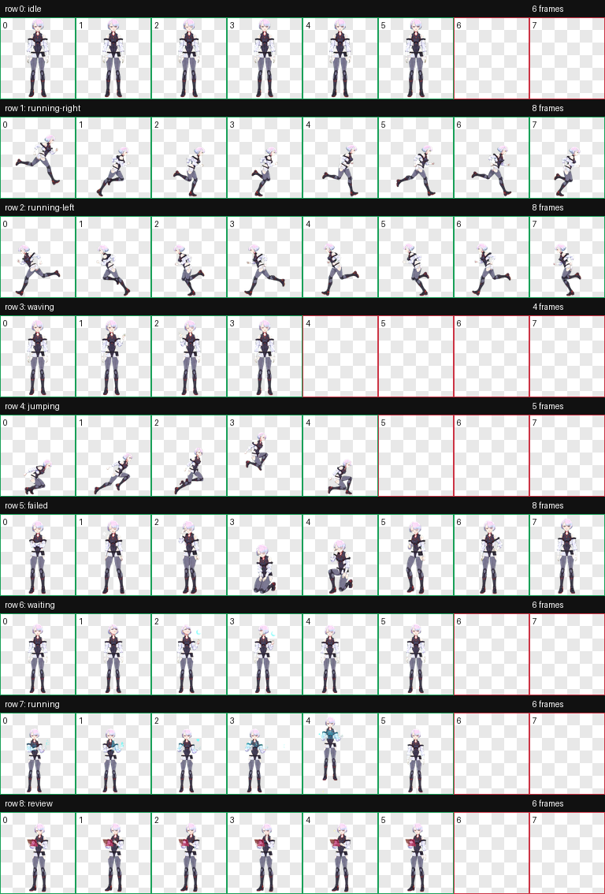
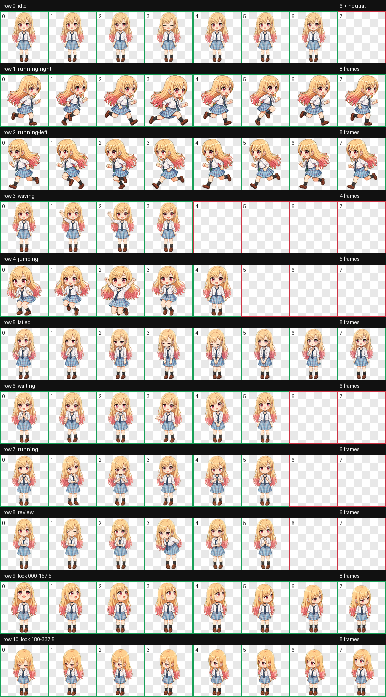
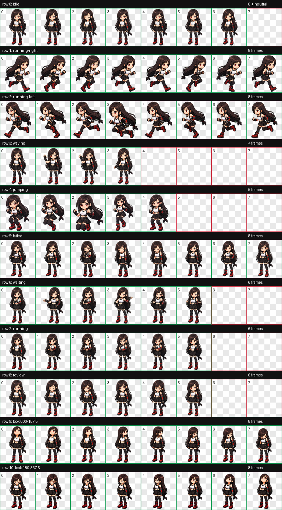
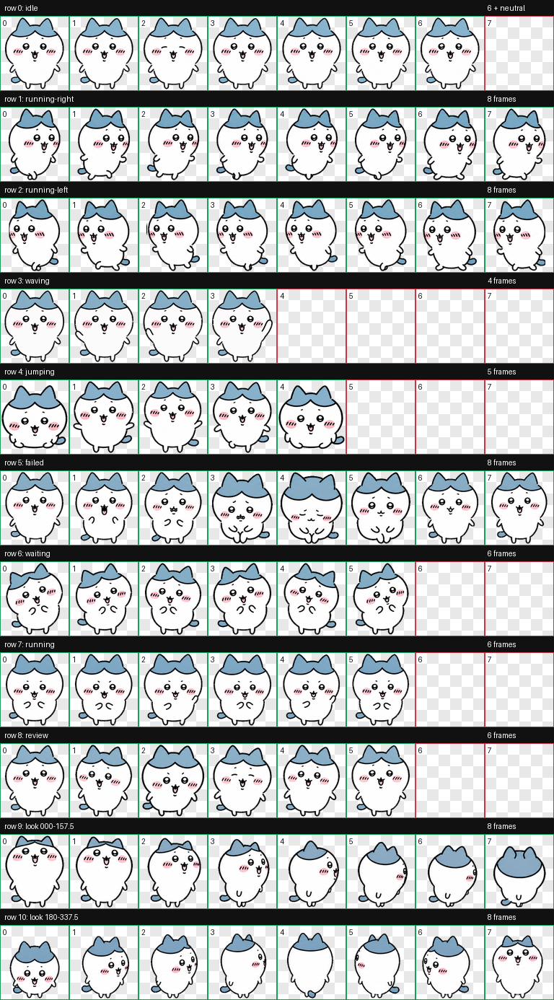

# AgentPets

用于保存、审查、安装和分享 Codex 自定义 Pets 的多 Pet 仓库。

这个仓库同时保留：

- `run/`：hatch-pet 的构建证据，包括 prompts、参考图、逐帧图、最终 atlas、
  QA 和验证结果。
- `package/`：Codex 可直接安装的 `pet.json + spritesheet.webp`。

> 本仓库不包含许可证，也不授予代码或美术素材的复用权。角色相关内容属于
> 非官方同人作品；公开或使用前请阅读
> [FAN-CONTENT-NOTICE.md](FAN-CONTENT-NOTICE.md)。

## Pets

| Pet | ID | Contract | 构建记录 | 安装包 |
| --- | --- | --- | --- | --- |
| [Lunablade](pets/lunablade/README.md) | `lunablade` | v1 | [BUILD.md](pets/lunablade/BUILD.md) | [`package/`](pets/lunablade/package/) |
| [Lucyblade](pets/lucyblade/README.md) | `lucyblade` | v2 | [BUILD.md](pets/lucyblade/BUILD.md) | [`package/`](pets/lucyblade/package/) |
| [Lucyna Kushinada](pets/lucyna_kushinada/README.md) | `lucyna_kushinada` | v1 | [BUILD.md](pets/lucyna_kushinada/BUILD.md) | [`package/`](pets/lucyna_kushinada/package/) |
| [Marin Kitagawa](pets/marin-kitagawa/README.md) | `marin-kitagawa` | v2 | [BUILD.md](pets/marin-kitagawa/BUILD.md) | [`package/`](pets/marin-kitagawa/package/) |
| [Tifa Lockhart](pets/tifa-lockhart/README.md) | `tifa-lockhart` | v2 | [BUILD.md](pets/tifa-lockhart/BUILD.md) | [`package/`](pets/tifa-lockhart/package/) |
| [Hachiware](pets/hachiware/README.md) | `hachiware` | v2 | [BUILD.md](pets/hachiware/BUILD.md) | [`package/`](pets/hachiware/package/) |

## Pets 预览

<table>
  <tr>
    <td align="center"><a href="pets/lunablade/README.md"><strong>Lunablade</strong></a><br></td>
    <td align="center"><a href="pets/lucyblade/README.md"><strong>Lucyblade</strong></a><br></td>
  </tr>
  <tr>
    <td align="center"><a href="pets/lucyna_kushinada/README.md"><strong>Lucyna Kushinada</strong></a><br></td>
    <td align="center"><a href="pets/marin-kitagawa/README.md"><strong>Marin Kitagawa</strong></a><br></td>
  </tr>
  <tr>
    <td align="center"><a href="pets/tifa-lockhart/README.md"><strong>Tifa Lockhart</strong></a><br></td>
    <td align="center"><a href="pets/hachiware/README.md"><strong>Hachiware</strong></a><br></td>
  </tr>
</table>

## 安装

将 `<pet-id>` 替换为表格里的 ID。

Windows PowerShell：

```powershell
powershell -NoProfile -ExecutionPolicy Bypass -File scripts/install-pet.ps1 -PetId <pet-id>
```

Windows、Linux 或 macOS 上的 PowerShell 7：

```powershell
pwsh -NoProfile -File scripts/install-pet.ps1 -PetId <pet-id>
```

如果同名 Pet 已存在，需要明确允许覆盖：

```powershell
pwsh -NoProfile -File scripts/install-pet.ps1 -PetId <pet-id> -Force
```

安装脚本按以下顺序决定 Codex home：

1. `-CodexHome` 参数；
2. `CODEX_HOME` 环境变量；
3. 当前平台的用户目录下 `.codex`。

默认安装位置：

- Windows：`%USERPROFILE%\.codex\pets\<pet-id>\`
- Linux：`$HOME/.codex/pets/<pet-id>/`
- macOS：`$HOME/.codex/pets/<pet-id>/`

目标目录中只会出现：

```text
pet.json
spritesheet.webp
```

然后在 Codex 中打开 **Settings > Pets > Refresh**，选择对应 Pet，再输入
`/pet`。

## 仓库结构

```text
AgentPets/
├── .github/workflows/validate.yml
├── AGENTS.md
├── FAN-CONTENT-NOTICE.md
├── catalog.json
├── docs/
│   ├── ADDING_A_PET.md
│   └── PUBLISHING.md
├── scripts/
│   ├── install-pet.ps1
│   ├── package-pet.ps1
│   ├── validate-pets.ps1
│   └── validate-publication.ps1
├── tests/
│   ├── cross-platform.ps1
│   ├── install-all.ps1
│   └── validate-publication.ps1
└── pets/<pet-id>/
    ├── README.md
    ├── BUILD.md
    ├── build.json
    ├── package/
    │   ├── pet.json
    │   └── spritesheet.webp
    └── run/
```

## 重新生成安装包

```powershell
pwsh -NoProfile -File scripts/package-pet.ps1 -PetId <pet-id>
```

脚本根据 `build.json` 指向的最终 WebP 确定性生成 `package/`。对于 v2 Pet，
生成的 manifest 必须包含 `spriteVersionNumber: 2`。

## 验证

```powershell
pwsh -NoProfile -File tests/validate-publication.ps1
pwsh -NoProfile -File tests/cross-platform.ps1
pwsh -NoProfile -File scripts/validate-pets.ps1
pwsh -NoProfile -File tests/install-all.ps1
```

验证覆盖：

- catalog、build metadata 和 package manifest 一致性；
- v1/v2 atlas 尺寸、PNG alpha 类型、WebP 哈希和 20 MiB package 上限；
- hatch-pet 验证及 QA 结果；
- Windows、Linux、macOS、WSL 与本地文件 URI 隐私路径；
- 非示例邮箱、常见本地 Codex 存储位置；
- 下划线/连字符 Pet ID、`CODEX_HOME` 和临时安装。

GitHub Actions 会在 Windows、Ubuntu 和 macOS 上运行同一组检查。

## 新增 Pet 与发布

- 新增 Pet：[docs/ADDING_A_PET.md](docs/ADDING_A_PET.md)
- 发布到 GitHub：[docs/PUBLISHING.md](docs/PUBLISHING.md)

发布前必须验证待推送的完整提交历史，不得包含本机绝对路径、私人邮箱、临时
目录或已经废弃的 Pet ID。提交作者应使用与 GitHub 账号关联的 noreply 邮箱。

## 历史完整性

不得为旧 Pet 伪造缺失的历史 manifest。缺失文件应记录在 Pet 的 `BUILD.md`
和 `build.json` 中；后补验证必须明确标记为后补验证。
