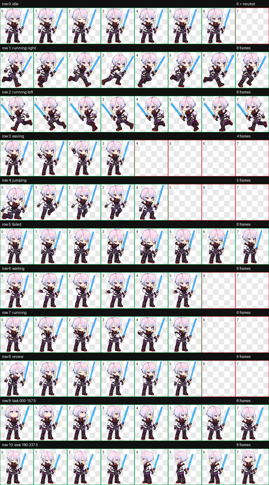

# Lucyblade

A pixel-chibi cyberpunk netrunner visibly inspired by Lucy, with short
silver-lavender hair, violet eyes, a black-white-red cyber outfit, and a vivid
blue lightsaber that remains part of the character in every state.



## Installation

The installable files are in [`package/`](package/):

```text
package/
├── pet.json
└── spritesheet.webp
```

Run from the repository root:

```powershell
powershell -NoProfile -ExecutionPolicy Bypass -File scripts/install-pet.ps1 -PetId lucyblade
```

Then select **Settings > Pets > Refresh > Lucyblade** in Codex and enter `/pet`.

## Build record

The complete current build artifacts are preserved in [`run/`](run/):

- `pet_request.json` and `imagegen-jobs.json`: the complete request and selected output for each visual job.
- `prompts/`: the main design, nine standard animations, direction anchors, look rows, and retry prompts.
- `references/`: Lucy-style references, the canonical base, layout guides, and direction-generation guides.
- `decoded/`: selected generated strips, direction anchors, and registration results.
- `qa/`: per-row frame inspection, GIFs, contact sheets, continuity measurements, three isolated blind reviews, and final validation.
- `generated/rejected/`: complete candidates rejected by direction semantics, loop continuity, or edge-safety gates.
- `final/`: the validated v2 PNG/WebP atlas used by the current package.

The original Lunablade remains available as the separate v1 Pet
[`../lunablade/`](../lunablade/). See [BUILD.md](BUILD.md) for reference
provenance and rebuild history, and [build.json](build.json) for
machine-readable metadata.

Before public use, read the repository's
[FAN-CONTENT-NOTICE.md](../../FAN-CONTENT-NOTICE.md).
