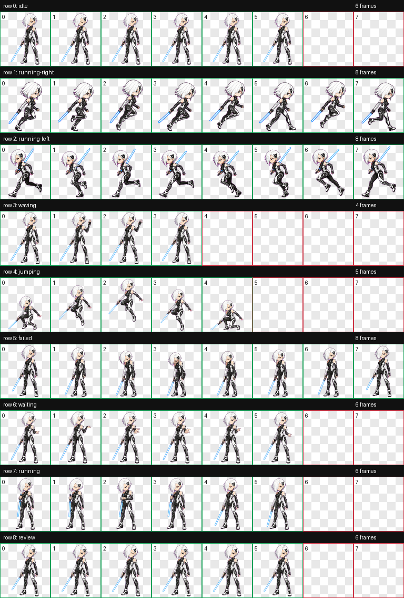

# Lunablade

白发、黑色装甲、蓝色能量刃的动画 Codex Pet。



## 使用

可安装内容位于 [`package/`](package/)：

```text
package/
├── pet.json
└── spritesheet.webp
```

从仓库根目录运行：

```powershell
powershell -NoProfile -ExecutionPolicy Bypass -File scripts/install-pet.ps1 -PetId lunablade
```

然后在 Codex 中选择 **Settings > Pets > Refresh > Lunablade**，再输入
`/pet`。

## 构建记录

完整的现有构建资产保存在 [`run/`](run/)：

- `prompts/`：基础角色、动作行、方向修复和重试 prompts。
- `references/`：canonical base 和 atlas 布局参考。
- `decoded/`：生成并解码的基础图与动作行。
- `frames/`：按状态拆分的动画帧。
- `final/`：标准 atlas、扩展 atlas 和验证结果。
- `qa/`：contact sheets、动作 GIF、方向检查和帧检查结果。

详细构建说明、已知缺失历史和后补验证见 [BUILD.md](BUILD.md)。机器可读的
构建元数据见 [build.json](build.json)。重做的 v2 版本作为独立 Pet 保存在 [`../lucyblade/`](../lucyblade/)。

公开使用前请阅读仓库根目录的 [FAN-CONTENT-NOTICE.md](../../FAN-CONTENT-NOTICE.md)。
